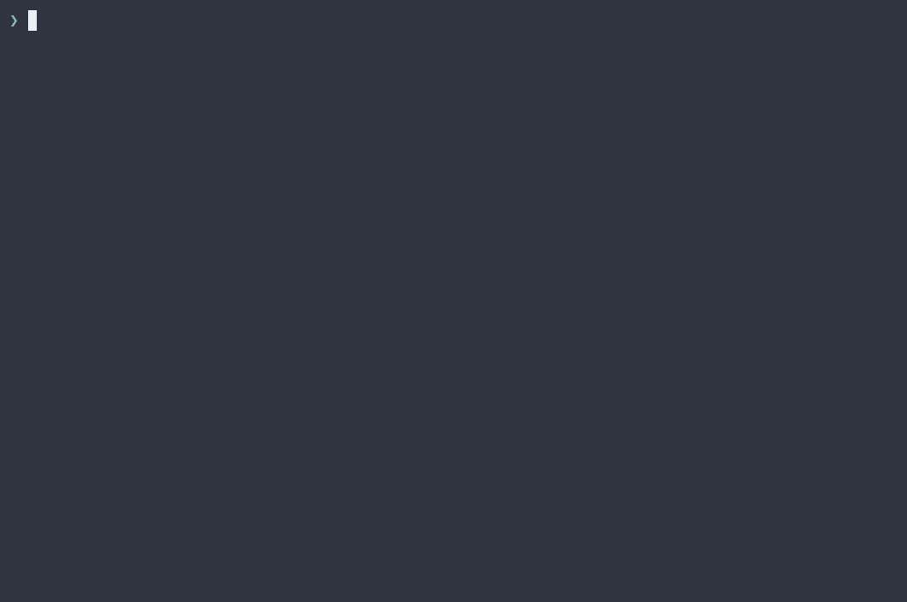

# notes

[](https://github.com/naterator/notes/actions/workflows/ci.yml) [](https://github.com/naterator/notes/releases/latest)

`notes` is a Go CLI and terminal editor for Markdown notes and daily journals. You can tag your notes, and they stay as ordinary files in a Git repository.

- The CLI commands work in pipes. You can create, find, list, edit, move, and delete notes.
- Daily journals with Activities, Actions, and Notes sections.
- The borderless TUI puts search up top, the editor on the left, and tags and notes on the right. Pick Traditional or Vim-style keys.
- You can sync with Git automatically, pick a theme, and update the binary when you’re ready.



[Replayable terminal recording](assets/demo.cast) · [Recording script](scripts/record_demo.py)

## Install

This downloads the latest binary for your Mac or Linux machine (amd64 or arm64).

```sh
curl -fLo notes "https://github.com/naterator/notes/releases/latest/download/notes-$(uname -s | tr A-Z a-z)-$(uname -m | sed 's/x86_64/amd64/;s/aarch64/arm64/')"
chmod +x notes
sudo mv notes /usr/local/bin/
```

## Build from source

You’ll need Git and Go 1.27.1 or newer.

```sh
git clone https://github.com/naterator/notes.git
cd notes
go build -trimpath -o notes ./cmd/notes
./notes version
sudo install -m 0755 notes /usr/local/bin/notes
```

## Set up

- Settings: `${XDG_CONFIG_HOME:-$HOME/.config}/notes/config.toml`.
- Notes: `${XDG_CONFIG_HOME:-$HOME/.config}/notes/repo` by default; use `--repo`, `NOTES_REPO`, or `notes config set repo PATH` to change it.
- Run `notes init` to initialize the configured directory as a Git repository. If the directory doesn’t have a Git repository yet, `notes tui` asks before creating one. Just press Enter if you want to exit. If you already have Markdown in that directory, it stays where it is and you can read it before setup. If a command would write notes before setup, it prints the matching `notes init` command.

If you want to sync your notes, add an origin remote.

```sh
repo="${XDG_CONFIG_HOME:-$HOME/.config}/notes/repo"
notes --repo "$repo" init
git -C "$repo" remote add origin YOUR_REMOTE_URL
```

Git sync needs `user.name`, `user.email`, and a reachable `origin` remote. A local Git repository without an origin supports normal editing. You can turn off automatic sync with `notes config set git.auto_sync false`.

## Quick start

```sh
notes init
note=$(notes new "Release checklist" --category work)
printf '# Release checklist\n\nDone.\n' | notes edit "$note" --stdin
notes tags set "$note" planning/release
notes list --tag-prefix planning --relative
notes tags --tree --counts
notes find release --note "$note" --matches
notes tui "$note"
```

Use `/` to nest tags. For example, `planning/release` appears under `planning` in the TUI tree and in `notes tags --tree`.

## Commands

- `notes init` initializes the local Git repository and prints its path. It also accepts the global `--repo` and `--config` options.
- `notes new "Idea" --tag inbox` creates a note and prints its path. Add `--category work`, `--path work/idea.md`, `--template FILE`, or `--stdin` as needed.
- `notes show NOTE` prints exact Markdown. `notes edit NOTE` opens the TUI unless you’ve configured an external editor. Use `notes edit NOTE --stdin < revised.md` to replace the entire note with exact Markdown from stdin.
- `notes list` (`l`, `ls`) shows `base: REPO/` and repository-relative paths without a leading slash in a terminal. Each entry can be used with `notes delete NOTE`. In a pipeline it prints absolute paths. `notes find QUERY` also prints paths. Use `--tag` for exact tags, `--tag-prefix` for a tag and its descendants, or `--untagged`. Both commands also accept `--category`, `--sort`, `--limit`, `--relative`, `--print0`, `--json`, and `--long`. Use `notes find QUERY --note NOTE --matches` to show matching lines in one note, and `--regex` for a regular expression.
- `notes tags`, `notes tags add NOTE TAG...`, and `notes tags remove NOTE TAG...` manage `#tags` in Markdown. Use slash-separated tags such as `planning/release`; `notes tags --tree --counts` shows the sidebar’s tag counts, including ancestors. `notes tags set NOTE TAG...` replaces the tag set. Pass `--yes` to remove omitted tags, including inline tags. Code, URLs, and escaped hashes are ignored.
- `notes move NOTE DESTINATION` (`mv`), `notes delete NOTE --yes` (`rm`), and `notes categories` (`cats`) manage files and folders.
- `notes journal` prints today's journal path. `notes journal add "Reviewed notes" --section actions --tag work` appends an entry; use `--date YYYY-MM-DD` for another day.
- `notes sync` (`save`) commits note changes, pulls from `origin`, and pushes. `notes sync status --json` inspects local state without network access.
- `notes config render`, `get KEY`, `set KEY VALUE`, `unset KEY`, `path`, and `edit` manage TOML settings.
- `notes tui` opens the terminal interface; `notes update --check`, `notes version`, and `notes completion SHELL` provide maintenance commands.
- Top-level commands accept short prefixes: `notes c` for categories, `co` for config, `com` for completion, `l` for list, `s` for show, and `sy` for sync. Other commands use `d`, `e`, `f`, `h`, `i`, `j`, `m`, `n`, `ta`, `t`, `u`, or `v`; longer prefixes work too.
- Nested commands also accept unambiguous prefixes, such as `notes co rend`, `notes j a`, `notes ta rem`, and `notes sy stat`.

For pipelines, path output has no color or headers. Use `--print0` for names with whitespace or newlines:

```sh
note=$(notes new "Quick thought" --tag inbox)
notes show "$note"
notes find 'thought' --print0 | xargs -0 -n 1 cat
```

`new --stdin` and `journal add --stdin` read prose from stdin. If the note saves but automatic sync fails, the command exits with code 3. Retry `notes sync` instead of repeating the write. Run `notes --help` or `notes COMMAND --help` for all flags.

## Terminal editor

- On first launch, Vim is preselected; choose Vim or Traditional (nano-like). The choice is saved as `tui.editor_mode`.
- The search box and sidebar have their own background shades. You can still see where focus and selection are with color off.
- Open the TUI without a note and focus starts in the search box. `notes tui NOTE` and TUI-backed `notes edit NOTE` start with the editor focused. `[FOCUS]`, a pane marker, and the footer show the current area and mode, including without color.
- `Ctrl+G` shows action keys: `n` new, `j` journal, `t` tags, `f` find in note, `a` all-notes search, `b` tree, `e` editor, `s` save, `y` sync, `r` refresh, `c` settings, `q` quit, `h` help. `Ctrl+S` and `Ctrl+Q` also work where the terminal passes them through.
- `Tab` cycles search → tree → editor. While you’re typing in the editor, Tab inserts a tab character. Press `Esc` before using Tab to change focus. Shift+Tab cycles backward outside entry mode.
- `?` opens help in command/navigation mode and types `?` during text entry. `Ctrl+G h` always opens help. `/` in the all-notes search opens search within the current note; `Ctrl+V` then `/` inserts a literal slash in the all-notes query.
- `:` in command mode opens built-in commands such as `:new`, `:tags`, `:find`, `:sync`, `:settings`/`:config`, `:themes`, `:w`, `:q`, and `:wq`. It is not a shell.
- In Vim normal mode, `gg` and `G` jump to the first and last line and `42G` jumps to line 42. Use `h/j/k/l`, `w/b/e`, `0/^/$`, and `Ctrl+F/B/D/U` to move. Edit with `i/a/I/A/o/O`, `x`, `r`, `D/C/Y`, `dd/dw/d$`, `cc/cw/c$`, `yy/yw`, and `p/P`. Use `u` to undo, `Ctrl+R` to redo, `.` to repeat common edits, `v/V` to select, and `/` then `n/N` to search. Traditional mode supports arrows, selection, `Ctrl+A/E`, `Ctrl+K/U`, and `Ctrl+O`.
- The TUI edits files up to 2 MiB. Configure an external editor to use `notes edit NOTE` for larger files. Autosave checks for external changes and offers a recovery draft instead of overwriting them.

## Settings and sync

- The default theme is qbitctl’s arctic blue-gray `default`. The other qbitctl themes are `ocean`, `forest`, `amber`, `rose`, `violet`, `mono`, `tookie`, `dracula`, `solarized`, `gruvbox`, `catppuccin`, `high-contrast`, `paper`, `midnight`, `terminal`, and `sunset`.
- `mocha` and `frappe` preserve the original Notes palettes. `history` also selects the previous Notes default, Mocha. Existing `catppuccin-mocha` and `catppuccin-frappe` settings still work. The previous Notes versions of `midnight`, `ocean`, `rose`, and `terminal` are available as `notes-midnight`, `notes-ocean`, `notes-rose`, and `terminal-native`.
- Run `notes config themes` to list themes, `notes config set theme NAME` to save one, or `notes --theme NAME tui` to try it for one launch. Sync and autosave defaults are `git.auto_sync = true`, `git.max_interval = "5m"`, and `tui.autosave_delay = "1s"`.
- Open interactive settings with `Ctrl+G c` or `:settings`. Search grouped settings, press Enter to edit/save one value, and use `Ctrl+R` to remove its saved preference. Esc cancels an edit or closes settings; `Ctrl+G h` shows help.
- `:themes` previews each theme as you browse. Press Enter to save it or Esc to go back to the theme you started with. Settings shows the saved values and where the active values come from, including environment variables and flags.
- Repository changes apply on the next launch and do not move notes. Editor keys, colors, and future autosave/sync settings can change during the session; selecting editor mode `ask` restores the prompt on the next launch. Config edits use the same validation and TOML rewriting as `notes config set`, including its comment/formatting behavior.
- Use `notes config render` for effective settings. Explicit flags override supported environment variables, which override TOML and defaults. `--theme`, `--color auto|always|never`, and `--no-color` control colors.
- Notes checks whether sync is due after CLI commands that change notes and on a timer while the TUI is open. If you want sync to run at a set time while Notes is closed, schedule `notes sync` with your OS if needed.
- Sync stages Markdown changes only, fetches, commits when needed, pulls, then pushes. Conflicts and offline failures leave local changes intact and pending; resolve them with Git and rerun `notes sync`.

## Go API

Import `github.com/naterator/notes` to use the same local Markdown store as the CLI and TUI. Supply absolute paths for the notebook and state directories. Each operation takes a context. Share the state directory with other Notes processes that write to the same notebook.

```go
book := notes.New(repoDir, stateDir)
note, err := book.Read(ctx, "work/ideas.md")
if err != nil {
    return err
}
body := []byte("# Ideas\n\nOne more idea.\n")
return book.Save(ctx, note.ID, note.Revision(), body)
```

`Save` reports `notes.ErrChanged` if another writer has changed the file since the read. The Go package works on local files. The CLI and TUI manage Git initialization and syncing.

## Updates and license

- `notes update --check` checks GitHub without changing the binary. `notes update` installs a newer release; a development build needs `--version X.Y.Z` (or `vX.Y.Z`) to install one explicitly.
- Releases contain one binary per supported OS/architecture, named `notes-OS-ARCH`. Before it replaces your binary, the updater checks the download against the SHA-256 digest in GitHub’s asset metadata. That catches a corrupt download. You still need to trust the release account.
- Source is BSD 3-Clause licensed; see [LICENSE](LICENSE). Color palettes: [Catppuccin](https://catppuccin.com/palette/), [Nord](https://www.nordtheme.com/docs/colors-and-palettes/), [Gruvbox](https://github.com/morhetz/gruvbox), and [Solarized](https://ethanschoonover.com/solarized/).
